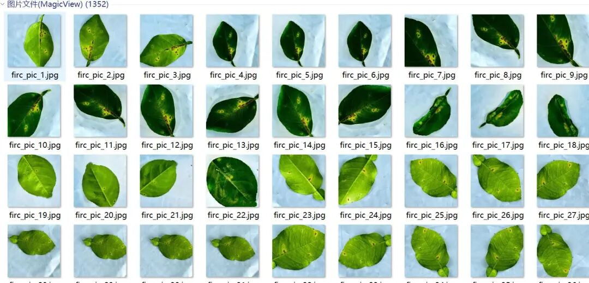
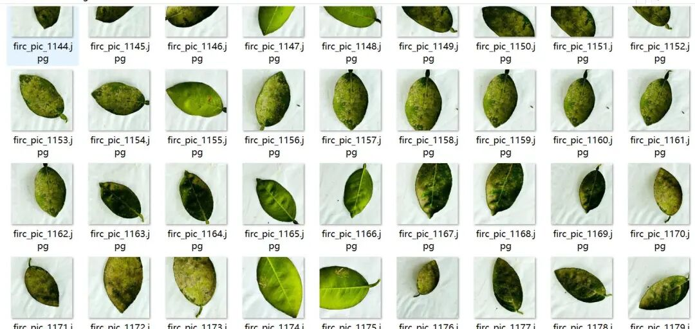
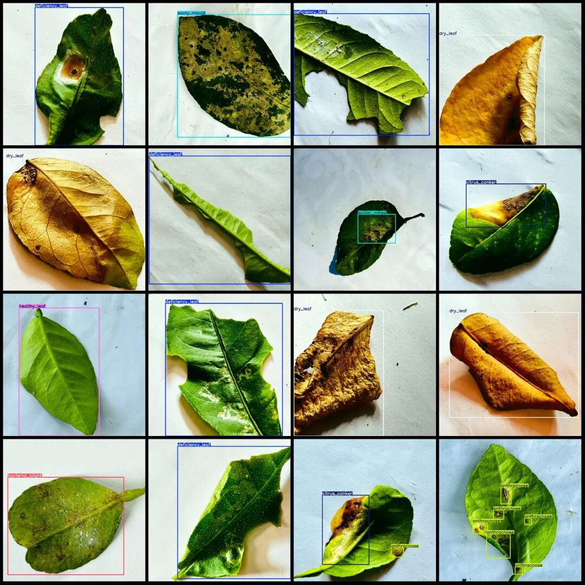
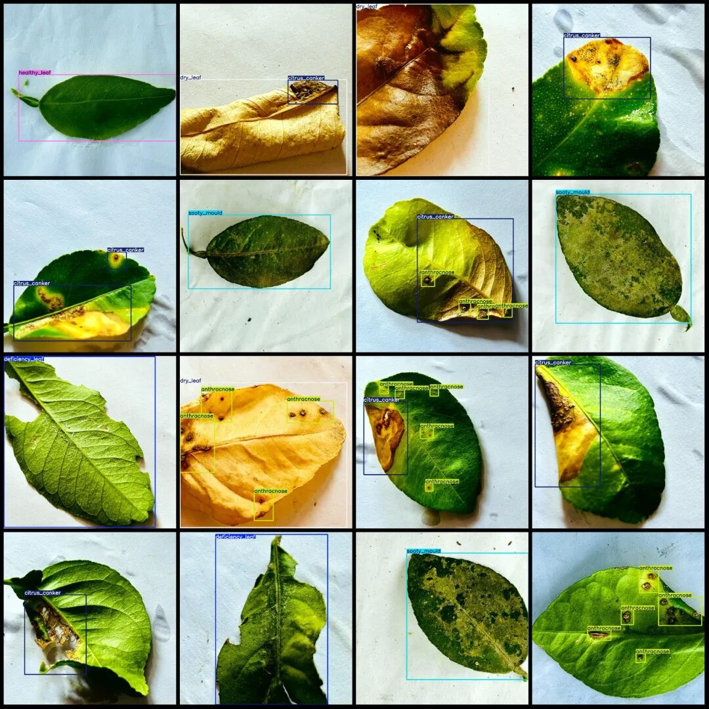

# Citrus Leaf Disease Detection Dataset VOC+YOLO format with 1352 images in 9 categories

Dataset format: Pascal VOC format + YOLO format (txt file without split path, only containing jpg images and corresponding VOC format xml files and yolo format txt files)

Number of images (number of jpg files): 1352

Number of annotations (number of xml files): 1352

Number of annotations (number of txt files): 1352

Label category count: 9

Label category names (Note that the order of categories in the YOLO format does not correspond to this, but is based on the classes.txt file in the labels folder): ["anthracnose", "bacterial_blight", "citrus_canker", "curl_virus", "deficiency_leaf", "dry_leaf", "healthy_leaf", "sooty_mold", "spider_mites"]

Number of boxes labeled in each category:

anthracnose (anthracnose) frame count = 959

Bacterial Blight (bacterial wilt) Frames = 109

citrus_canker (citrus canker) frame count = 205

curl_virus (curly leaf virus) frame count = 125

deficiency_leaf (Deficient Leaf)frames = 193

dry_leaf (dry leaf) frame count = 183

Healthy Leaf (Healthy Leaves) Frame Count = 209

sooty_mould (coal stain) frame count = 153

spider_mites (red spider/leaf mites) = 116

Total frames: 2252

Number of images per category:

Anthracnose (anthracnose) occupies 288 images.

Bacterial Blight (bacterial wilt) occupies 105 images.

citrus_canker (citrus ulcer disease) has 194 images.

curl_virus (curly virus) occupies 125 images

deficiency_leaf (Deficient Leaf) occupies 193 images

dry_leaf (dry leaf) occupies = 183

Healthy Leaf (Healthy Leaves) occupies 209 images.

sooty_mould (coal stain) occupies = 153

spider_mites (red spider/leaf mites) occupying the image = 116

Image resolution: 1000x1000

Using labelImg:

Annotation rules: Draw a rectangle around the category.

Important Notice: The dataset does not have separate training, validation, and test sets; you need to partition them yourself.

Special : This dataset does not guarantee the accuracy of the trained models or weight files.

Image Preview:

Annotation example:

## Payment

Here is a pay link on Stripe ( https://buy.stripe.com/3cs8yP7sY87d0vu9AB ). Please contact me lonlonago@foxmail.com after funding $89, and I will send you a complete data files , thank you!

